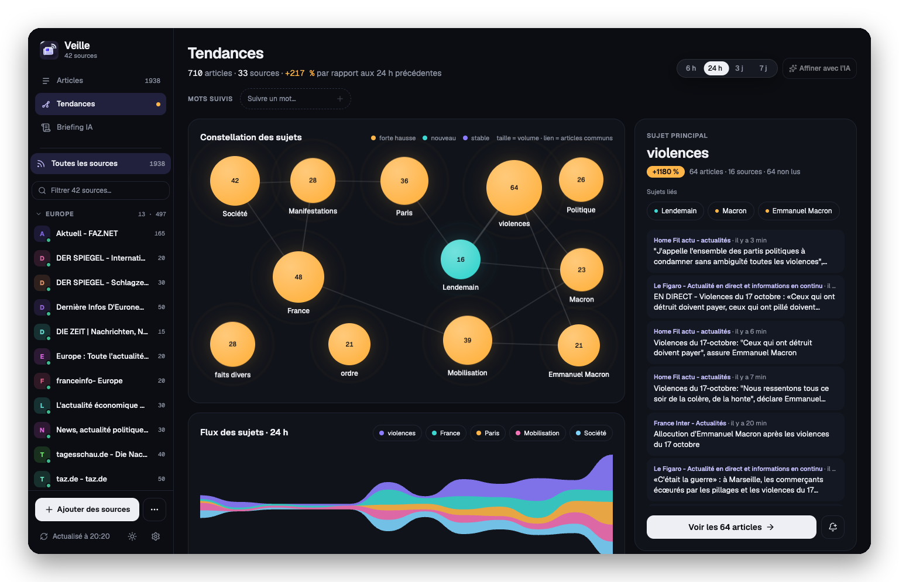
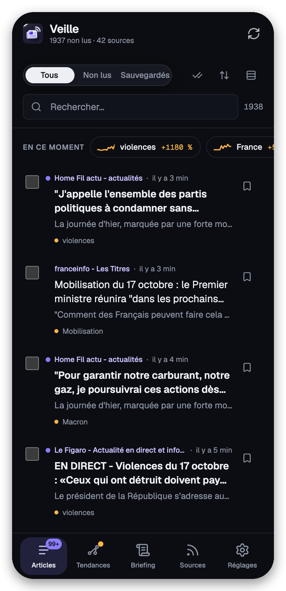
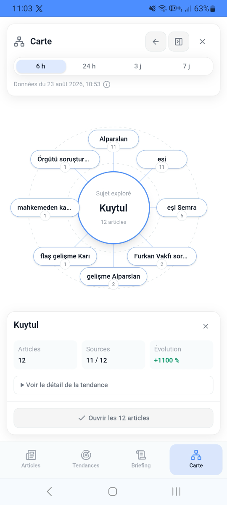

<p align="center">
  
</p>

<h1 align="center">Veille RSS</h1>

<p align="center">
  <strong>Votre veille de presse, au même endroit.</strong><br>
  Centralisez vos sources, classez vos lectures, repérez les sujets qui montent<br>
  et produisez des briefings assistés par IA — sans compte utilisateur.
</p>

<p align="center">
  
  
  
  
  <a href="LICENSE"></a>
</p>

<p align="center">
  <a href="#aperçu">Aperçu</a> ·
  <a href="#fonctionnalités">Fonctionnalités</a> ·
  <a href="#démarrage-rapide">Démarrage</a> ·
  <a href="#auto-hébergement-avec-docker">Docker</a> ·
  <a href="#architecture-technique">Technique</a>
</p>

<p align="center">
  <a href="https://vercel.com/new/clone?repository-url=https%3A%2F%2Fgithub.com%2Fkilianvivien%2FVeilleRSS"></a>
</p>

> **Déploiement recommandé : Vercel.** Le dépôt contient également une image Docker autonome pour les personnes qui souhaitent auto-héberger l'application.

---

## Aperçu

### Tableau de veille sur ordinateur



<p align="center"><sub>Sources, articles et tendances réunis dans un tableau de veille à trois volets.</sub></p>

### Une interface pensée pour le mobile

<p align="center">
  
  &nbsp;&nbsp;
  
</p>

<p align="center"><sub>Une navigation tactile dédiée sur iPhone et Android, jusqu'à la cartographie des sujets.</sub></p>

---

## À quoi sert l'application ?

Veille RSS s'adresse aux journalistes, chercheurs, analystes, communicants et à toute personne qui consulte régulièrement plusieurs médias. Elle remplace l'ouverture manuelle de nombreux sites par un espace unique : les nouvelles publications arrivent dans une liste, les contenus importants peuvent être sauvegardés et les tendances sont calculées à partir de l'ensemble des articles reçus.

L'intelligence artificielle est facultative. Sans clé API, la lecture, la recherche, le classement et l'analyse locale des tendances restent pleinement utilisables.

<table>
  <tr>
    <td width="25%"><strong>📰 Centraliser</strong><br><sub>RSS, Atom, catalogue de sources et OPML.</sub></td>
    <td width="25%"><strong>🔎 Trier</strong><br><sub>Recherche, non lus, sauvegardes et sélections.</sub></td>
    <td width="25%"><strong>📈 Comprendre</strong><br><sub>Tendances, mots-clés et cartographie locale.</sub></td>
    <td width="25%"><strong>✨ Synthétiser</strong><br><sub>Traduction et briefings IA facultatifs.</sub></td>
  </tr>
</table>

## Fonctionnalités

### 🛰️ Sources et collecte

- ajout de n'importe quel flux RSS ou Atom à partir de son URL ;
- détection automatique du flux lorsqu'une page web compatible est collée ;
- catalogue de plus de 200 sources prêtes à l'emploi : presse française (nationale, régionale, audiovisuelle, économique), action publique et administration, Belgique et Suisse francophones, presse européenne (Allemagne, Europe du Sud, du Nord, centrale et orientale), presse turque, médias internationaux, Moyen-Orient et Afrique du Nord, Afrique, Asie-Pacifique, Amériques et institutions européennes ;
- classement des sources par catégories ;
- import et export OPML pour migrer facilement depuis ou vers un autre lecteur RSS ;
- sauvegarde complète dans un fichier (sources, articles, mots-clés suivis, réglages) et restauration sur n'importe quel appareil ;
- actualisation manuelle ou automatique, avec une fréquence réglable par source ;
- indicateur de santé des flux et déduplication des articles.

### 📖 Lecture et organisation

- vues **Tous les articles**, **Non lus** et **Sauvegardés** ;
- recherche instantanée dans les titres, extraits, auteurs et noms de sources ;
- tri par date ou par source et choix de la densité d'affichage ;
- marquage lu/non lu, sauvegarde et sélection multiple ;
- lecteur intégré avec taille de texte réglable et lien vers l'article original ;
- partage d'un article en un geste, vers la carte de partage du système ou le presse-papiers, dans sa version originale ou traduite ;
- navigation tactile : tirer pour actualiser, balayer un article pour le classer et passer au précédent ou au suivant dans le lecteur ;
- export d'une sélection d'articles en Markdown.

### 📈 Tendances et suivi

- analyse locale sur une fenêtre de 6 heures, 24 heures, 3 jours ou 7 jours ;
- comparaison avec la période précédente, volumes, évolutions et mini-graphiques ;
- détection des termes en progression à partir des articles déjà collectés ;
- suivi de mots-clés et filtrage immédiat des articles correspondants ;
- notifications locales pour les nouveaux résultats lorsque l'application tourne en arrière-plan ;
- cartographie interactive des sujets et de leurs termes associés.

### ✨ Intelligence artificielle

- traduction d'un article vers la langue choisie ;
- affinage des tendances afin d'écarter les termes trop génériques ;
- génération d'un briefing éditorial, avec conclusions, statistiques et graphiques ;
- fournisseur différent possible pour la traduction et pour la veille ;
- prise en charge de Gemini, Mistral, OpenRouter, Albert, Apple Foundation Models sur Mac et d'un modèle local compatible (Ollama ou LM Studio).

Les appels IA sont envoyés depuis le navigateur au fournisseur configuré. Apple Foundation Models passe par un relais limité à la boucle locale du Mac. Les clés API sont stockées dans le `localStorage` de l'appareil : utilisez de préférence des clés dédiées, limitées en quota, et évitez les appareils partagés.

### Apple Foundation Models depuis la PWA Vercel

Sur un Mac compatible avec Apple Intelligence et macOS 27, le fournisseur **Apple Foundation Models** utilise le modèle « system » présent sur l'appareil. Il ne demande pas de clé API. Ouvrez un terminal et lancez le serveur Apple :

```bash
fm serve --host 127.0.0.1 --port 1976
```

#### Avec Chrome ou Edge sur le Mac

Dans un second terminal, depuis le dossier du projet, lancez le relais local :

```bash
npm run apple:bridge
```

Ouvrez [https://veille-rss.vercel.app](https://veille-rss.vercel.app) dans Chrome ou Edge sur ce Mac, puis choisissez **Apple Foundation Models** dans **Paramètres → Intelligence artificielle**. Autorisez l'accès au réseau local si le navigateur le demande et utilisez **Tester la connexion**. Gardez les deux terminaux ouverts pendant l'utilisation. Les données déjà enregistrées sur Vercel restent accessibles : l'adresse de la PWA ne change pas.

`fm serve` refuse les requêtes de génération envoyées directement par un site web. Le relais écoute uniquement sur `127.0.0.1:1977`, accepte uniquement l'origine `https://veille-rss.vercel.app`, puis transmet les requêtes au modèle local sur `127.0.0.1:1976`. Les prompts ne transitent pas par Vercel. Pour un autre déploiement HTTPS, définissez `VEILLE_RSS_ORIGIN` avant de lancer le relais.

#### Avec Safari sur le Mac

Safari bloque les appels HTTP locaux depuis la PWA HTTPS. Installez [mkcert](https://github.com/FiloSottile/mkcert#installation), puis créez un certificat pour `127.0.0.1` depuis le dossier du projet :

```bash
brew install mkcert
mkcert -install
mkdir -p .local-certs
mkcert -cert-file .local-certs/127.0.0.1.pem -key-file .local-certs/127.0.0.1-key.pem 127.0.0.1
```

`mkcert -install` ajoute une autorité de certification locale au trousseau macOS. Vérifiez cette demande système et gardez sa clé privée sur ce Mac. Le dossier `.local-certs/` est exclu de Git. Avec `fm serve` dans le premier terminal, lancez le relais HTTPS dans un second terminal :

```bash
APPLE_BRIDGE_TLS_CERT=.local-certs/127.0.0.1.pem \
APPLE_BRIDGE_TLS_KEY=.local-certs/127.0.0.1-key.pem \
npm run apple:bridge
```

Dans Safari, ouvrez la PWA Vercel, choisissez **Apple Foundation Models**, remplacez **Adresse du relais local** par `https://127.0.0.1:1977/v1/chat/completions`, puis cliquez sur **Tester la connexion**. Gardez les deux terminaux ouverts pendant l'utilisation. N'ignorez pas les alertes de certificat : si Safari en affiche une, vérifiez que `mkcert -install` a bien terminé et que l'adresse configurée est `127.0.0.1`.

### 📲 Application installable et hors connexion

- installation sur ordinateur, Android, iPhone et iPad depuis le navigateur ;
- interface responsive adaptée aux écrans tactiles ;
- thème clair ou sombre ;
- démarrage et consultation hors connexion des articles déjà chargés ;
- détection des nouvelles versions avec proposition de mise à jour ;
- raccourcis PWA et partage d'une URL vers l'application sur les plateformes compatibles ;
- tutoriel de prise en main au premier lancement.

> La récupération de nouveaux flux, la traduction et la génération IA nécessitent une connexion. Les notifications sont locales : sans serveur de notification, elles ne peuvent pas réveiller une application complètement fermée. Sur iPhone, elles nécessitent l'installation de la PWA.

---

## Démarrage rapide

### Utiliser le déploiement Vercel

Vercel est la cible principale du projet. Le bouton ci-dessous crée un projet avec le site statique, la fonction sécurisée de proxy RSS et les en-têtes nécessaires à la PWA :

[](https://vercel.com/new/clone?repository-url=https%3A%2F%2Fgithub.com%2Fkilianvivien%2FVeilleRSS)

Aucune variable d'environnement n'est requise. Les clés des fournisseurs IA sont saisies ensuite dans **Paramètres → Intelligence artificielle** et restent propres à chaque navigateur.

### Installer l'application sur son appareil

1. Ouvrez le site dans Chrome, Edge ou Safari.
2. Utilisez le bouton **Installer l'application** proposé dans les paramètres.
3. Sur iPhone ou iPad, choisissez **Partager → Sur l'écran d'accueil**.

Le tutoriel intégré guide ensuite l'ajout des premières sources.

## Auto-hébergement avec Docker

La release `v0.5.0` fournit un déploiement Docker secondaire et autonome. Le conteneur compile l'interface, sert les fichiers statiques et expose le proxy RSS sur le même domaine.

Téléchargez l'archive `veille-rss-0.5.0-docker.tar.gz` depuis la [release GitHub](https://github.com/kilianvivien/VeilleRSS/releases/tag/v0.5.0), puis décompressez-la et ouvrez un terminal dans le dossier obtenu. Docker avec Docker Compose doit être installé. L'image est construite sur votre machine ; une connexion Internet est nécessaire pour télécharger Node.js et les dépendances.

```bash
tar -xzf veille-rss-0.5.0-docker.tar.gz
cd veille-rss-0.5.0
```

> **En bref :** aucune base de données, aucun volume et aucune variable secrète ne sont nécessaires. Les données restent dans le navigateur de chaque utilisateur.

### Avec Docker Compose

```bash
docker compose up -d --build
```

Ouvrez ensuite [http://localhost:8080](http://localhost:8080). Pour arrêter le service :

```bash
docker compose down
```

### Avec Docker seul

```bash
docker build -t veille-rss:0.5.0 .
docker run --name veille-rss -p 8080:8080 --restart unless-stopped veille-rss:0.5.0
```

Le port interne peut être changé avec `PORT`. En production, placez idéalement le conteneur derrière un reverse proxy HTTPS :

```bash
docker run -p 3000:3000 -e PORT=3000 veille-rss:0.5.0
```

Un point de contrôle est disponible sur `/healthz`. Aucune persistance Docker n'est nécessaire, car les données utilisateur sont stockées dans le navigateur et non dans le conteneur.

---

## Développement local

### Prérequis

- Node.js 22 ou supérieur ;
- npm 10 ou supérieur recommandé.

```bash
git clone https://github.com/kilianvivien/VeilleRSS.git
cd VeilleRSS
npm ci
npm run dev
```

L'application est alors accessible sur [http://localhost:5174](http://localhost:5174). Le serveur Vite fournit automatiquement `/__rss-proxy`, car la plupart des éditeurs n'autorisent pas un navigateur à télécharger directement leurs flux (CORS).

### Commandes utiles

| Commande | Rôle |
| --- | --- |
| `npm run dev` | Lance le serveur de développement sur le port 5174 |
| `npm run build` | Vérifie TypeScript et produit le build dans `dist/` |
| `npm run preview` | Prévisualise le build avec un proxy RSS local |
| `npm run apple:bridge` | Relie la PWA Vercel au `fm serve` du même Mac |
| `npm run typecheck` | Vérifie les types sans produire de fichiers |
| `npm test` | Exécute la suite de tests Vitest |
| `npm run check:feeds` | Vérifie les flux du catalogue en ligne avec le proxy de production et le parseur du lecteur |
| `docker compose up -d --build` | Construit et lance le package Docker |

### Vérifier les sources du catalogue

Dans la fenêtre **Sources**, le bouton **Vérifier** de chaque bouquet lit ses flux et indique le nombre d’articles datés utilisables. La disponibilité peut varier selon l’éditeur et le réseau ; un contrôle réussi ne garantit pas la disponibilité future ni l’accès au texte intégral des articles.

Pour les contributeurs, `npm run check:feeds` contrôle tout le catalogue. On peut aussi cibler un ou plusieurs identifiants de bouquets ou de sources, ou une URL HTTPS candidate :

```bash
npm run check:feeds -- regional-europe regional-africa
npm run check:feeds -- ap-rnz-pacific
```

Ce contrôle utilise directement le code de la fonction Vercel (validation DNS et redirections, délai de 8 secondes, plafond de 5 Mio), puis le parseur de l’application. Il échoue si aucun article daté avec un lien HTTP(S) n’est lisible et affiche la date de l’article le plus récent pour repérer les flux abandonnés. Il nécessite un accès réseau et reste séparé de `npm test`. L’option `--json` produit un résultat structuré.

Le [relevé de vérification de l’extension internationale](docs/feed-catalog-verification.md) précise les sources testées et les limites du contrôle.

## Architecture technique

Veille RSS est une application web monopage en React 19 et TypeScript, construite avec Vite 8. L'état est géré avec Zustand et l'interface utilise Tailwind CSS 4, Radix UI et Lucide.

| Couche | Technologies | Responsabilité |
| --- | --- | --- |
| Interface | React 19, TypeScript, Tailwind CSS 4, Radix UI | Lecture, navigation responsive et accessibilité |
| État local | Zustand, IndexedDB, localStorage | Sources, articles, statuts et préférences |
| Analyse | Modules TypeScript locaux | Déduplication, tendances, mots-clés et cartographie |
| IA | Connecteurs chargés à la demande | Traduction, affinage et briefing |
| Livraison | Vite, Vercel Functions, PWA, Docker | Build, proxy RSS, cache et auto-hébergement |

```text
src/
├── components/       Interface, lecteur, tendances, carte, paramètres et PWA
├── lib/ai/           Connecteurs et routage des fournisseurs IA
├── lib/rss/          Collecte, parsing, OPML, déduplication et analyse locale
├── lib/pwa/          Installation, mises à jour et notifications
├── stores/           État persistant Zustand
└── views/            Vue principale de veille
api/rss-proxy.ts      Fonction de proxy RSS pour Vercel
scripts/apple-fm-bridge.mjs  Relais Apple local, accessible depuis la PWA Vercel
docker/server.mjs     Serveur statique et proxy RSS de l'image Docker
public/               Manifeste, icônes et captures
```

### Stockage des données

- **IndexedDB** : sources, articles, statuts lu/sauvegardé, sélections et résultats de veille — un enregistrement par source et par article, pour ne réécrire que ce qui change ;
- **localStorage** : préférences d'interface, configuration IA et clés API ;
- **aucune base de données serveur** et aucun compte utilisateur.

Le navigateur peut effacer ces données si l'utilisateur supprime les données du site. **Paramètres → Sauvegarde** exporte un fichier JSON complet (sources, articles, mots-clés suivis, réglages) et le restaure, sur cet appareil ou un autre. Ce fichier ne contient ni clé API ni adresse de relais IA. L'export OPML, lui, ne couvre que la liste des sources.

### Pourquoi un proxy RSS ?

L'application essaie d'abord de lire le flux depuis le navigateur de chaque utilisateur. Quand l'éditeur autorise ces requêtes (CORS), aucun appel à la fonction Vercel n'est nécessaire. Si l'accès direct échoue ou ne renvoie pas un flux lisible, l'application utilise une route du même domaine. Elle mémorise localement cet échec pendant une heure pour éviter les tentatives répétées :

- `/__rss-proxy` avec le serveur Vite en développement ;
- `/api/rss-proxy` avec une Function sur Vercel ;
- `/api/rss-proxy` avec le serveur Node intégré à l'image Docker.

Les proxys de production limitent les protocoles, refusent les destinations locales ou privées, revalident les redirections et plafonnent la durée et la taille des réponses afin de réduire les risques SSRF et les abus.
Les flux qui bloquent CORS continuent donc à utiliser le proxy ; leur récupération ne peut pas être entièrement déplacée dans le navigateur sans perdre ces sources.

### PWA et cache

Le service worker est généré au moment du build avec un identifiant déterministe basé sur les fichiers produits. Il précache le cœur de l'application, met les vues secondaires en cache à l'usage et conserve les articles déjà enregistrés dans IndexedDB. Les en-têtes Vercel existants restent la configuration de référence ; Docker reproduit les règles de cache nécessaires aux ressources et au service worker.

## Vie privée et sécurité

- Les données de veille ne sont pas synchronisées vers un serveur du projet.
- Les éditeurs des flux accessibles directement reçoivent les requêtes du navigateur et peuvent voir l'adresse IP de l'utilisateur.
- Les fournisseurs IA ne reçoivent du contenu que lorsqu'une action IA est lancée.
- Chaque fournisseur applique ses propres conditions de conservation et de traitement.
- Les clés API présentes dans le navigateur sont accessibles au code exécuté sur cette origine : déployez uniquement une version de confiance et protégez l'accès à l'appareil.
- L'application assainit le HTML des flux avant affichage, mais un flux ou un article externe reste une source tierce.

## Limites connues

- Certains éditeurs protègent ou désactivent leur flux et peuvent refuser le proxy.
- Les données ne sont pas synchronisées automatiquement entre plusieurs appareils.
- Le mode hors connexion porte sur l'application et les éléments déjà chargés, pas sur la récupération de nouvelles actualités.
- Les fonctions IA peuvent engendrer des coûts auprès du fournisseur choisi.

## Contribuer

Les issues et pull requests sont les bienvenues. Avant de proposer un changement :

```bash
npm run typecheck
npm test
npm run build
```

Merci de ne jamais committer de clé API ou de donnée privée. Les changements concernant le proxy RSS doivent conserver les protections contre les réseaux privés, les redirections non contrôlées, les réponses trop volumineuses et les requêtes trop longues.

## Licence

Ce projet est distribué sous licence [MIT](LICENSE). © 2026 Kilian Vivien.

<p align="center"><sub>Conçu pour transformer un flux d'actualités en veille exploitable.</sub></p>
